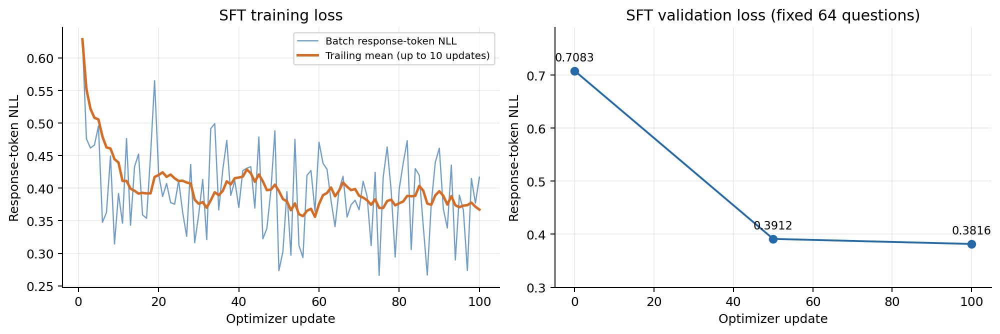
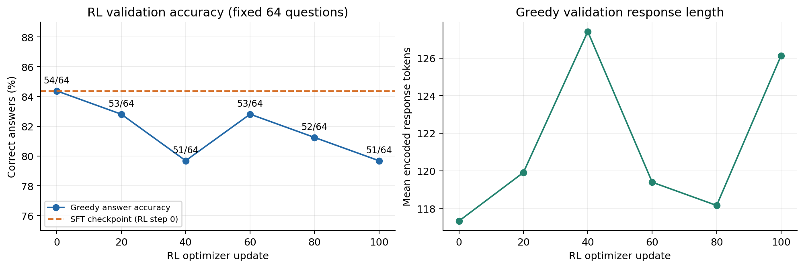
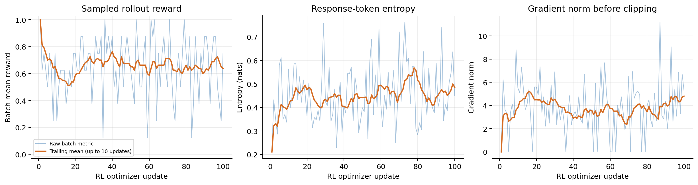
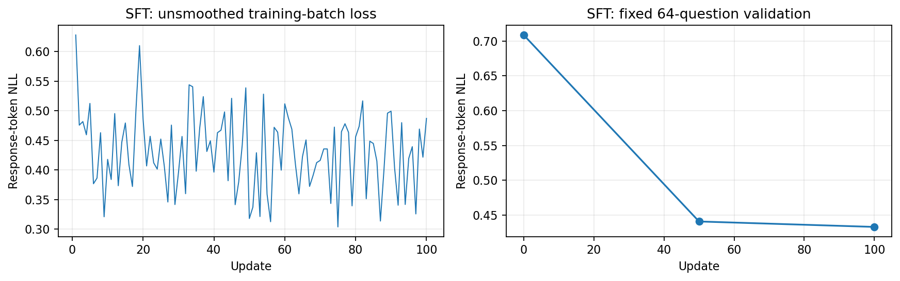
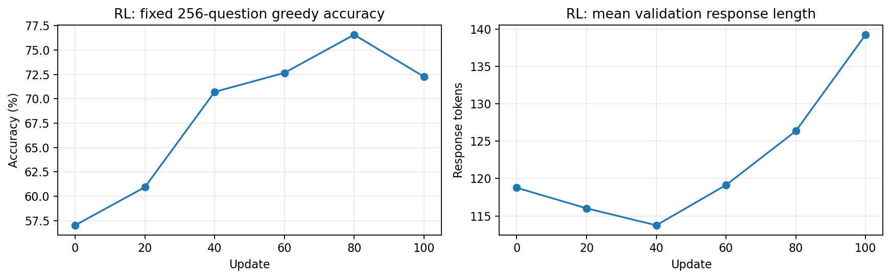
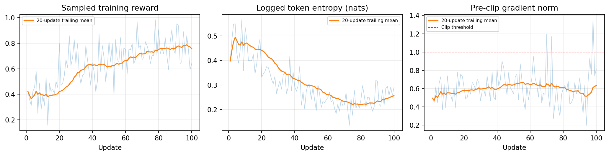

# Assignment 5: GSM8K SFT and GRPO Training Results

FSDP2 SFT and GRPO are available through `--training-backend fsdp2`.
The 9B pipeline now launches two ranks and uses a separate vLLM module for generation;
training and inference share the GPUs in separate phases. 
Local CPU/DTensor and launcher tests pass; real two-GPU/vLLM acceptance requires NVIDIA hardware and vLLM.

The text backbone of **Qwen/Qwen3.5-4B-Base** was fine-tuned on GSM8K in two completed
SFT-to-RL experiments: an initial BF16-parameter run and an FP32-parameter/BF16-autocast
rerun. Each experiment completed **100 SFT updates and 100 RL updates** on one NVIDIA
H20. The rerun used GPU 0 of a two-H20 instance; neither vLLM nor CPU optimizer offload
participated in these results.

In the rerun, SFT validation NLL fell from **0.708530 to 0.433164**. RL then raised greedy
accuracy on a fixed 256-question validation sample from **57.03125% (146/256)** to
**72.265625% (185/256)**, peaking at **76.5625% (196/256)** at update 80. Only update 100
was saved. These evaluations used the in-memory FP32 policy before BF16 export; the
saved model has not been independently reevaluated here. This is one seed and a short
training budget, without a hyperparameter sweep, a controlled ablation or a test-set result.

## Model and Dataset Size

| Property | Value |
| --- | ---: |
| Base model | Qwen/Qwen3.5-4B-Base |
| Loaded class | Qwen3_5ForCausalLM, text backbone |
| Trainable parameters | **4,205,751,296**, approximately 4.206 billion |
| Decoder layers | 32: 24 linear-attention and 8 full-attention |
| Hidden / MLP intermediate dimension | 2,560 / 9,216 |
| Full-attention query / KV heads | 16 / 4; head dimension 256 |
| Linear-attention key / value heads | 16 / 32; head dimensions 128 |
| Vocabulary / model context limit | 248,320 / 262,144 tokens |
| SFT sequence limit | 1,024 tokens, including prompt and response |
| RL generation limit | 512 new tokens per answer, in addition to the prompt |
| Original GSM8K train / test records | 7,473 / 1,319 |
| Training / held-out validation questions | **6,726 / 747**, seed 42 |
| SFT NLL evaluation | First 64 validation questions; 8,167 supervised tokens |
| Initial / rerun RL evaluation | First 64 / first 256 validation questions |

The input embedding and output head share weights. The visual branch was not trained.
The exported BF16 files contain the same number of elements as the unique model parameters,
without a duplicate tied embedding. The two experiments' train and validation JSONL files
match byte-for-byte by SHA-256; all examples survived the SFT length filter.

SFT uses standard GSM8K reasoning and final-answer demonstrations with response-only
teacher forcing, including EOS supervision. RL samples grouped answers and scores the
explicit final numeric answer with `gsm8k_numeric`. Both stages use the R1-style prompt
and `</think> <answer> ... </answer>` response format. The independent GSM8K test split
was not evaluated in either experiment.

## Initial BF16 Training Result (2026-10-23)

### Experimental Design and Training Budget

| Property | SFT | RL |
| --- | ---: | ---: |
| Parameter / gradient / AdamW-moment storage | BF16 | BF16 |
| Learning rate / weight decay | 1e-5 / 0 | 1e-6 / 0 |
| Optimizer updates | 100 | 100 |
| Training microbatch / gradient accumulation | 1 / 8 | 1 / 8 |
| Questions / answers per question per RL update | Not applicable | 2 / 4 |
| Effective batch per update | 8 demonstrations | 8 sampled answers |
| Examples / sampled answers processed | 800 | 800, from 200 question selections |
| Supervised / response-mask tokens processed | 105,192 | 105,025 |
| Generation backend / generation batch | Not applicable | Transformers / 1 |
| Gradient checkpointing | Enabled, non-reentrant | Disabled |
| Advantage / loss normalization | Not applicable | Mean-centered, std-scaled / per-sequence token mean |
| Evaluation schedule | Updates 0, 50, 100; 64 questions | Updates 0, 20, 40, 60, 80, 100; 64 questions |

Both stages used AdamW and a gradient-clipping threshold of 1.0. RL used temperature
1.0, `top_k=0`, `top_p=1.0`, and one optimizer update per fresh rollout batch. The basic
entry had no importance ratio, PPO clipping, reference-policy KL, entropy bonus or critic.

### Validation Result

| Measurement | Start | End | Change |
| --- | ---: | ---: | ---: |
| Fixed-64 SFT NLL | 0.708294 | 0.381645 | -0.326649 |
| Fixed-64 SFT perplexity | 2.030524 | 1.464691 | -0.565833 |
| Fixed-64 RL greedy accuracy | 54/64, 84.375% | 51/64, 79.6875% | **-4.6875pp** |

This run did not demonstrate a validation improvement after RL. Its first/last
20-update mean training rewards were 0.600 / 0.625; 12 of 100 updates had a recorded
zero pre-clip gradient norm and 88 exceeded the clipping threshold. These observations
do not identify the cause of the outcome or establish that every parameter update was lost.

#### Validation and Training Curves

### Runtime and Memory

| Measurement | SFT | RL |
| --- | ---: | ---: |
| Recorded job wall time | 2,049s, 34min9s | 4,440s, 74min |
| Sum of update-stage times | 247.54s | 124.66s |
| Sum of generation-stage times | Not applicable | 2,933.61s |
| Successful-run GPU memory peak | Not recorded | Not recorded |

SFT wall time includes the first model download. The stage times are host wall durations,
not isolated CUDA kernel timings. Generation accounts for 66.07% of the RL job wall time.
The remaining time includes operations that were not individually timed.

## FP32 and BF16 Mixed-Precision Training Result (2026-10-24)

### Precision Policy

| Computation or data | Policy |
| --- | --- |
| Live model parameters, accumulated parameter gradients | FP32 |
| AdamW moments and parameter updates | FP32, on GPU 0 |
| Eligible forward operations | CUDA BF16 autocast |
| SFT cross-entropy and RL selected-token log-probability computation | FP32 |
| Logged token entropy | Diagnostic under no_grad; not an entropy bonus |
| Gradient checkpointing | Non-reentrant; recomputes model-layer activations |
| Model files exported to SSD | BF16, with tied weights preserved |

Autocast does not make every operation BF16. RL computes selected-token log probabilities
using gather minus logsumexp and still materializes full-vocabulary FP32 logits. Checkpointing
reduces retained model activations; it does not remove the logits or entropy's temporary tensors.

### Experimental Design and Training Budget

| Property | SFT | RL |
| --- | ---: | ---: |
| Initialization | Same 4B Base model | Rerun SFT checkpoint-000100 |
| AdamW learning rate / weight decay | 1e-5 / 0 | 2e-6 / 0 |
| Training microbatch / gradient accumulation | **8 / 1** | **4 / 16** |
| Questions / answers per question per RL update | Not applicable | **8 / 8** |
| Effective batch per update | 8 demonstrations | 64 sampled answers |
| Optimizer updates | 100 | 100 |
| Examples / sampled answers processed | 800 | **6,400**, from 800 question selections |
| Supervised / response-mask tokens processed | 105,192 | **842,899** |
| Generation backend / generation batch | Not applicable | Transformers / **8** |
| Gradient clipping threshold | 1.0 | 1.0 |
| Evaluation schedule | Updates 0, 50, 100; first 64 validation questions | Updates 0, 20, 40, 60, 80, 100; first 256 validation questions |
| Saved checkpoints | Update 100, with optimizer/RNG state | Update 100, without optimizer state |

SFT stopped at `max_steps=100`, before completing its epoch. RL retained temperature 1.0,
`top_k=0`, `top_p=1.0`, the 512-new-token limit, seed 42 and the numeric reward function.
The grouping and training budget are larger than in the first run.

RL advantages subtract each group's mean without dividing by its standard deviation.
The loss sums answer-token losses and divides by the **actual response-token count of the
current rollout batch**, shared by all microbatches in that update. This denominator
varies across batches; `constant` does not mean a fixed cross-training denominator.
The basic entry still uses no importance ratios, clipping objective or reference-policy KL.

### Validation Result

| SFT update | Fixed-64 NLL | Perplexity |
| ---: | ---: | ---: |
| 0 | 0.708530 | 2.031004 |
| 50 | 0.440959 | 1.554197 |
| 100 | **0.433164** | **1.542129** |

The final SFT NLL is higher than the first run's 0.381645 on the same fixed sample.
There is no measured basis for turning BF16 update rounding into a fixed effective-learning-rate
reduction. Precision, numerical execution and microbatching differ between these runs.

#### SFT Validation and Training Curves

Training losses below are unsmoothed individual-update measurements. Validation uses
three fixed-sample measurements; the horizontal axis is optimizer updates.

| RL update | Correct / 256 | Accuracy | Format rate | Mean response tokens |
| ---: | ---: | ---: | ---: | ---: |
| 0: SFT initialization | 146 | 57.03125% | 98.4375% | 118.77 |
| 20 | 156 | 60.93750% | 98.8281% | 116.02 |
| 40 | 181 | 70.70313% | 100.0000% | 113.74 |
| 60 | 186 | 72.65625% | 100.0000% | 119.14 |
| **80: best recorded evaluation** | **196** | **76.56250%** | 100.0000% | 126.37 |
| **100: final in-memory policy** | **185** | **72.26563%** | 97.6563% | 139.27 |

The final policy answers 39 more questions correctly than its own starting point:
**+15.234375 percentage points**. The best observation gains 50 questions, but its weights
were not saved. Updates 80–100 lose 11 correct answers while responses lengthen and six
final responses fail the format grader. The recorded final accuracy is measured before
BF16 export, and is not a reload test of the saved model.

#### RL Validation Curves

### Training Reward and Update Diagnostics

| Measurement | Result |
| --- | ---: |
| Sampled correct answers | **4,124 / 6,400**, 64.4375% |
| Mean reward, first / last 20 updates | **0.422656 / 0.757812** |
| Zero pre-clip gradient updates | **0 / 100** |
| RL updates exceeding the 1.0 clipping threshold | **3 / 100** |
| RL mean pre-clip gradient norm | 0.612700 |
| SFT updates exceeding the clipping threshold | 100 / 100 |
| SFT mean pre-clip gradient norm | 5.347843 |

The five 20-update mean rewards rise from 0.42266 to 0.62578, 0.66484, 0.75078 and 0.75781.
Individual batches still fluctuate. Entropy falls over most of training and rises again
near the end. The bold curve below is a trailing mean, not an independent measurement.

### Runtime and Memory

| Measurement | SFT | RL |
| --- | ---: | ---: |
| Approximate job wall time | **280.40s**, 4min40s | **6,489.32s**, 1h48min9s |
| Sum / mean of update-stage times | 158.83s / 1.588s | 1,137.42s / 11.374s |
| Sum / mean of generation-stage times | Not applicable | 4,136.09s / 41.361s |
| Successful-run GPU memory peak | Not recorded | Not recorded |

Rerun wall times are estimated from each job-name timestamp to its final log modification
time; no explicit launcher exit timestamp was supplied. Generation uses **78.43% of the
logged generation-plus-update stages**, or **63.74% of the approximate RL job wall time**.
The rest was not independently timed. The generation bottleneck remains substantial.

An earlier RL attempt with training microbatch 8 failed with a logged CUDA OOM;
microbatch 4 completed. The failed allocation does not measure the successful run's peak.
These timings also do not isolate precision or batching speedups: sample counts, answer
lengths and evaluation budgets differ, and the first SFT job included downloading.

## Comparison and Interpretation

| Measurement | Initial BF16 run | FP32/BF16-autocast rerun |
| --- | ---: | ---: |
| SFT final NLL, same 64 questions | 0.381645 | 0.433164 |
| RL sampled answers | 800 | 6,400 |
| RL validation sample size | 64 | 256 |
| RL start / end accuracy | 84.375% / 79.6875% | 57.03125% / 72.265625% |
| Within-run accuracy change | -4.6875pp | +15.234375pp |
| Zero-gradient / clipped RL updates | 12 / 88 | 0 / 3 |

The first 64 questions are a subset of the 256-question sample, but rerun logs do not
provide all per-question outcomes needed to extract its first-64 score. The SFT starting
checkpoints differ as well. Consequently, absolute accuracies are not comparable as a
controlled experiment, and the aggregate counts are not a complete paired significance test.

Precision, learning rate, normalization, group size, rollout batch, generation batching
and evaluation size changed together. The rerun demonstrates improvement for this
recipe on this fixed sample; it does not isolate which change caused it. No independent
test evaluation or multi-seed replication is available. A checkpoint reload evaluation
and saving the best validation checkpoint remain useful next checks.
